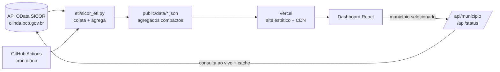

# 🌱 Painel do Crédito Rural no Brasil

Dashboard interativo, aberto e gratuito sobre as contratações de **crédito rural no Brasil**, com dados oficiais da
[Matriz de Dados do Crédito Rural (SICOR/Banco Central)](https://dadosabertos.bcb.gov.br/dataset/matrizdadoscreditorural).

Explore **custeio, investimento, comercialização e industrialização** do Brasil inteiro até o município. Os recortes
disponíveis são ano, atividade (agrícola/pecuária), programa (Pronaf, Pronamp, RenovAgro…) e métrica (valor, número de
contratos ou valor médio).

## Funcionalidades

- **Mapa coroplético** (MapLibre GL) com navegação Brasil → estado → município, hover e clique para detalhar
- Alternância **estados / municípios** no nível nacional (5,5 mil polígonos renderizados em WebGL)
- **KPIs**: valor contratado, contratos, ticket médio, área financiada, participação no Brasil e variação contra o
  *mesmo período* do ano anterior (para não comparar ano parcial com ano fechado)
- **Ranking** de estados ou municípios, com clique para selecionar
- **Série mensal** e **série histórica anual** empilhadas por finalidade
- Quebras por **programa**, **fonte de recursos**, **sexo do beneficiário**, **produtos financiados** e **instituições
  financeiras** (com segmento)
- **Consulta ao vivo no BCB** ao escolher um município: série mensal e produtos de custeio/investimento vêm direto da API
- **Busca de município** com autocompletar (ignora acentos)
- **URL compartilhável**: todo filtro fica na URL (`?ano=2025&uf=31&mun=3143302&at=1`)
- Responsivo, tema escuro, respeita `prefers-reduced-motion`

## Fontes do crédito: microdados + API

| Workflow | Fonte | O que gera |
|---|---|---|
| `atualizar-microdados.yml` (diário) | [Microdados do SICOR](https://www.bcb.gov.br/estabilidadefinanceira/tabelas-credito-rural-proagro), arquivos `.gz` mensais | **Base principal**: Brasil e UFs completos (mês, finalidade, atividade, programa, fonte, produto, instituição) e municípios **parciais** |
| `atualizar-dados.yml` (diário) | API OData do SICOR (Olinda) | Completa o que os microdados não trazem: município de **todas** as operações e sexo do beneficiário. Se a API estiver fora, termina em ~1 min |
| `atualizar-pam.yml` (semanal) | IBGE SIDRA 5457 | Produção agrícola municipal |
| `atualizar-inadimplencia.yml` (diário) | SCR.data + SGS (BCB) | Inadimplência do crédito rural por UF e série nacional oficial |

Os microdados públicos só trazem o município das operações com recursos públicos ou Proagro (arquivo
`SICOR_COMPLEMENTO_OPERACAO_BASICA`). Em 2023, isso cobriu 78% dos contratos e 33% do valor; ficam de fora
principalmente LCA e recursos livres não equalizados. O ETL grava essa cobertura por ano em `meta.munCobertura`, e o
painel avisa sempre que mostra municípios. Quando a API volta, o workflow da API substitui os municípios pelos dados
completos.

Conferência: em 2023, os microdados batem com a API da Matriz no custeio de MG (R$ 29.409.567.821 contra
R$ 29.409.567.815; 120.342 contratos nos dois) e nos totais nacionais (diferença de 0,001% no custeio, por registros
posteriores).

## Risco e inadimplência

Aba própria no painel (`?aba=risco`), com duas fontes do Banco Central:

- **SCR.data** ([dados abertos](https://dadosabertos.bcb.gov.br/dataset/scr_data)): arquivos anuais
  `scrdata_{ANO}.zip`, com um CSV por mês desde jun/2012. Usa só a modalidade *Financiamentos rurais e
  agroindustriais*. Dá carteira ativa, carteira inadimplida (operações com parcela vencida há mais de 90 dias),
  vencido acima de 90 dias e ativo problemático, por UF, PF/PJ, submodalidade, porte, origem dos recursos e
  segmento da instituição.
- **SGS**: séries oficiais da inadimplência do crédito rural (recursos direcionados, atraso > 90 dias), nacionais:
  21148 (PF), 21136 (PJ), 21146 (PF com taxas de mercado) e 21147 (PF com taxas reguladas).

Limitações, exibidas também no app:
- A modalidade do SCR.data junta crédito rural e financiamentos agroindustriais; o filtro de submodalidade ajuda a
  separar as linhas.
- Não há dado por município.
- O SCR.data sai com cerca de 2 meses de defasagem e pode divergir de outras publicações do BCB.
- O conceito de ativo problemático mudou em jan/2025.

O ETL (`etl/inadimplencia_etl.py`, workflow `atualizar-inadimplencia.yml`) só baixa os anos cujo arquivo mudou
e grava em `inad_meta.json` as submodalidades encontradas, para conferência.

## Crédito × produção agrícola (PAM/IBGE)

O painel cruza o crédito com a **Produção Agrícola Municipal** (IBGE, [SIDRA 5457](https://sidra.ibge.gov.br/tabela/5457)),
que reúne lavouras temporárias e permanentes. A tabela 1612 tem só as temporárias e deixaria de fora café, laranja,
banana e cacau.

- **Mapa "Crédito × Produção"** com o quociente de localização:
  QL = (crédito do município ÷ crédito da referência) ÷ (produção do município ÷ produção da referência).
  A referência é o Brasil ou, com uma UF selecionada, a própria UF.
- **Dispersão** crédito × produção por município (escala log), com a linha de QL = 1
- **Indicadores**: R$ de crédito por R$ 100 produzidos, correlação de Spearman, % da produção em municípios sem crédito
  agrícola e número de municípios com QL ≥ 2 ou < 0,5
- **Por cultura**: fatia no valor da produção × fatia no custeio agrícola (soja, café, milho, cana…), com a
  correspondência SICOR ↔ PAM definida em `etl/pam_etl.py`
- Opção **"PAM do ano seguinte"**, porque o custeio de um ano financia em boa parte a safra colhida no seguinte

Escolhas de método: só entra o crédito de **atividade agrícola**, porque a PAM não cobre pecuária. Os valores são
nominais e do mesmo período. O QL mede proporção, não necessidade de crédito.

## Arquitetura



**Por que híbrido?** A API do SICOR é lenta (às vezes dezenas de segundos), devolve HTTP 500 de forma intermitente e um
único mês da base municipal passa de 10 MB. Consultar tudo pelo navegador a cada filtro tornaria o painel inutilizável.
Por isso:

1. **ETL diário** (`etl/sicor_etl.py`, só biblioteca padrão do Python) consulta a API mês a mês, agrega e grava JSONs
   compactos. Ele reconsulta os **3 meses mais recentes** a cada execução, porque os registros chegam com atraso.
2. **Funções serverless** (`api/`) consultam o BCB **ao vivo** para o detalhe de um município e para o status da fonte,
   com cache de CDN (6 h no ano corrente, 7 dias em anos fechados).

O dashboard mostra a data da última sincronização e avisa quando o BCB já publicou um mês que o painel ainda não tem.

### Arquivos gerados (`public/data`)

| Arquivo | Conteúdo | Fonte (entidade OData) |
|---|---|---|
| `meta.json` | anos, meses disponíveis, dicionários | — |
| `serie_anual.json` | ano × UF × atividade × programa | `RegiaoUF` |
| `uf_AAAA.json` | mês × UF × atividade × programa × fonte | `RegiaoUF` |
| `mun_AAAA.json` | município × atividade × programa (+ área) | `CusteioInvestimentoComercialIndustrialSemFiltros` |
| `prod_AAAA.json` | UF × finalidade × produto × atividade × programa | `Custeio/Invest/ComercRegiaoUFProduto` |
| `if_AAAA.json` | UF × instituição × segmento × atividade × programa | `SegmentoIFRegiaoUF` |
| `gen_AAAA.json` | UF × sexo × atividade × programa | `RegiaoUFGenero` |
| `pam_AAAA.json` | município × cultura (área colhida, valor da produção) + total | IBGE SIDRA 5457 |
| `pam_meta.json` | anos da PAM e correspondência de culturas SICOR ↔ PAM | — |

Cada linha traz quantidade e valor para as 4 finalidades.

## Como publicar (Vercel + GitHub)

1. Crie um repositório (ex.: `Benfluc/painel-credito-rural`) e envie esta pasta:
   ```bash
   git init && git add . && git commit -m "Painel do Crédito Rural"
   git branch -M main
   git remote add origin https://github.com/Benfluc/painel-credito-rural.git
   git push -u origin main
   ```
2. No GitHub, abra **Settings → Actions → General → Workflow permissions** e marque **Read and write permissions**
   (o ETL faz commit dos dados).
3. Em **Actions → "Atualizar dados do SICOR (microdados)" → Run workflow**, rode a primeira carga com `inicio = 2013`
   (cerca de 1,3 GB de arquivos do BCB; leva de 15 a 40 minutos).
   A carga completa leva de 1 a 3 horas, por causa da lentidão da API. Se cair no meio, rode de novo: o cache mensal
   continua de onde parou.
4. Em **Actions → "Atualizar dados da PAM (IBGE)" → Run workflow**, rode a carga da PAM. Ela leva alguns minutos e
   depois roda toda segunda-feira.
5. Na [Vercel](https://vercel.com/new), importe o repositório. O preset **Vite** é detectado sozinho e não precisa de
   variáveis de ambiente. Cada commit do ETL gera um novo deploy.

> Antes da primeira carga, o painel funciona em **modo amostra**: são respostas reais do BCB gravadas para teste
> (estados 2022–2023; municípios e produtos só jan/2023), e um aviso amarelo fica visível no topo.

## Rodando localmente

```bash
npm install
npm run dev                     # http://localhost:5173  (sem /api: a consulta ao vivo tenta o BCB direto)
npx vercel dev                  # inclui as funções /api
python3 etl/sicor_etl.py --inicio 2023 --out public/data   # coleta real (precisa de acesso ao BCB)
```

Opções do ETL: `--inicio`, `--fim`, `--refresh N` (meses recentes a reconsultar), `--workers`, `--so-gerar`
(só regenera os JSONs a partir do cache) e `--fixtures DIR` (lê respostas gravadas).

## Metodologia e limites

- Valores **nominais** (sem correção pela inflação), pela **data de emissão** do contrato.
- **Programas agrupados**: Pronaf (0001), Pronamp (0050), Sem vínculo (0999), RenovAgro/ABC+ (0156, 0222, 0180) e Outros.
- **Fontes agrupadas**: obrigatórios, poupança rural, LCA, livres, fundos constitucionais, BNDES/Finame e outras.
- Fonte de recursos, produtos, instituições e sexo são publicados **por UF**. Ao escolher um município, esses gráficos
  mostram o estado dele.
- **Sexo do beneficiário**: códigos 1 e 2 tratados como masculino e feminino; demais códigos agrupados como
  "PJ / não informado".
- A malha municipal (IBGE, simplificada) não tem os municípios criados mais recentemente, e o polígono de Paraty (RJ)
  está incompleto na base de origem. Esses municípios aparecem no ranking e na busca, mas não no mapa.
- **Conferência**: com respostas reais da API, os totais de 2022 e 2023 por finalidade batem com a soma oficial
  (contratos exatos; valores com diferença de poucos reais, por arredondamento).

## Stack

React 18 · TypeScript · Vite · Tailwind CSS 4 · MapLibre GL · Recharts · Framer Motion · Vercel Functions · Python (ETL)

## Créditos e licença

- Dados: **Banco Central do Brasil**, licença [ODbL](https://opendatacommons.org/licenses/odbl/)
- Malha municipal: IBGE, via [tbrugz/geodata-br](https://github.com/tbrugz/geodata-br)
- Produção agrícola: **IBGE**, Produção Agrícola Municipal (SIDRA 5457)
- Respostas de amostra da API: gravadas pelo projeto [agrobr](https://github.com/bruno-portfolio/agrobr)
- Código: MIT, © Lúcio Júnio Benfica Rosa
