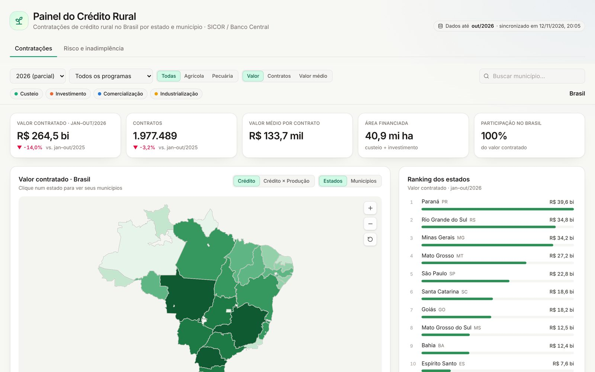
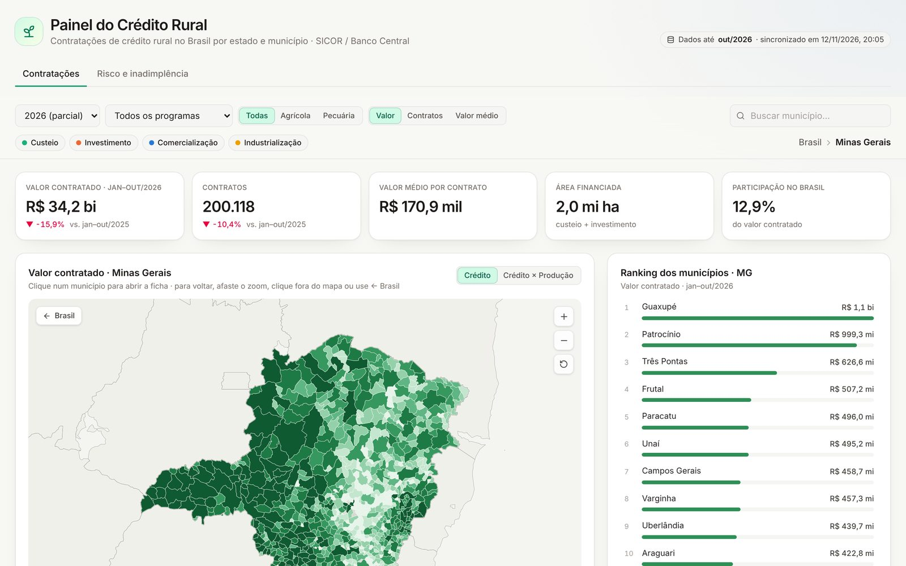
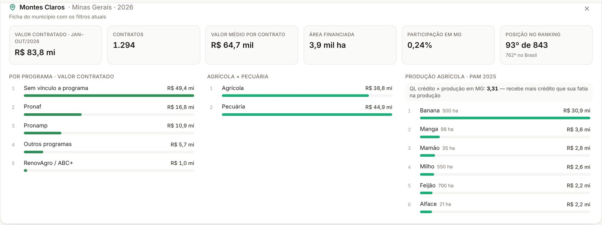
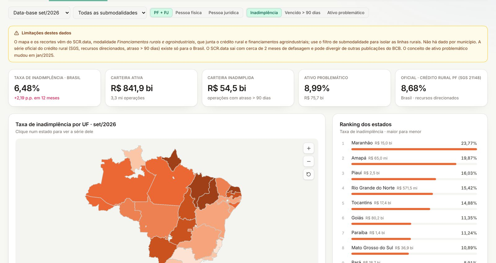
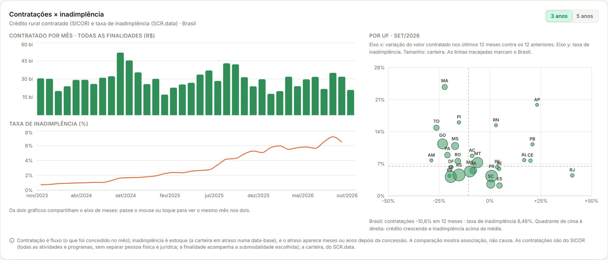
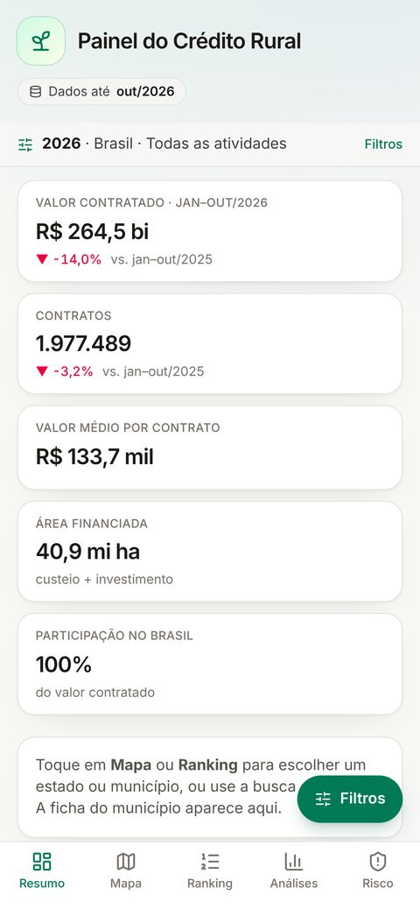
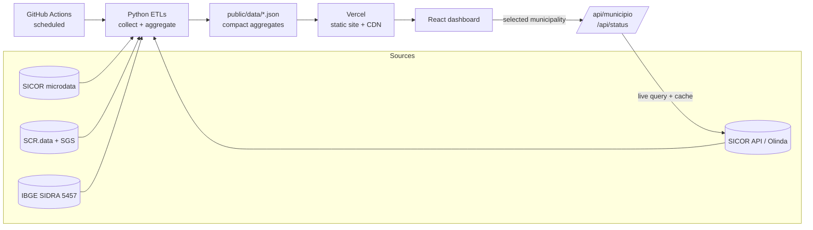

# 🌱 Brazil Rural Credit Dashboard

**English** · [Português](README_pt.md)

An interactive, open and free dashboard on **rural credit in Brazil**: where the money is lent, what it is for, how
closely it follows agricultural output and how delinquency is evolving. It uses official data from the Central Bank of
Brazil (SICOR, SCR.data and SGS) and IBGE (Municipal Agricultural Production), updated automatically.

**🔗 Live:** https://painel-credito-rural.vercel.app

> The interface is in Brazilian Portuguese.



## What the dashboard shows

### Loan contracts (SICOR)

- **Interactive map** from Brazil → state → municipality, covering **operating costs (custeio), investment, marketing
  and processing** loans. Filters for year, activity (crop/livestock), program (Pronaf, Pronamp, RenovAgro…) and metric
  (amount, number of contracts or average amount).
- **Indicators**: amount lent, contracts, average amount, financed area and share of Brazil. Changes are always
  measured against the **same period** of the previous year, so a partial year is never compared with a full one.
- **Ranking** of states or municipalities, clickable to select.
- **Monthly and historical series** (since 2013) by loan purpose.
- Breakdowns by **program**, **funding source**, **borrower sex**, **financed products** and **financial
  institutions**.
- **Municipality profile**: clicking a municipality shows its amount, contracts, area, share of the state, rank within
  the state and the country, programs, crop × livestock split and main crops from the PAM.
- **Easy map navigation**: to return to Brazil, zoom out, click outside the state or use the ← Brasil button.





### Credit × agricultural output (PAM/IBGE)

The dashboard cross-references credit with IBGE's **Municipal Agricultural Production** survey
([SIDRA 5457](https://sidra.ibge.gov.br/tabela/5457)), which covers both temporary and permanent crops (including
coffee, oranges, bananas and cocoa).

- **"Credit × Production" map** using the location quotient (LQ):
  LQ = (municipality's credit ÷ reference credit) ÷ (municipality's output ÷ reference output).
  The reference is Brazil or, when a state is selected, that state.
- **Scatter plot** of credit × output by municipality (log scale), with the LQ = 1 line.
- **Indicators**: R$ of credit per R$ 100 of output, Spearman correlation, % of output in municipalities with no crop
  credit and the number of municipalities with LQ ≥ 2 or < 0.5.
- **By crop**: share of output value × share of crop operating credit (soybeans, coffee, corn, sugarcane…).
- A **"next year's PAM"** option, because one year's operating credit largely finances the harvest of the following
  year. When that year's PAM has not been published yet, the dashboard says so.

### Risk and delinquency (SCR.data + SGS)

A dedicated tab (`?aba=risco`):

- **State map and ranking** of the delinquency rate, the amount overdue by more than 90 days or problem assets, with
  filters for reference date, sub-modality (operating costs, investment, marketing…) and individuals/companies.
- **Indicators**: rate, active portfolio, delinquent portfolio, problem assets and the official BCB series.
- **Monthly trend** since June 2012, compared with the official rural credit series (SGS 21148 and 21136).
- **Loans × delinquency**: monthly lending and the delinquency rate on the same time axis, plus a state-level chart
  that compares 12-month lending growth with current delinquency.
- National breakdowns by **borrower size**, **funding origin** and **institution segment**.





### Mobile

A dedicated layout with bottom tabs (Summary, Map, Ranking, Analyses and Risk), filters in a slide-up panel and stacked
indicators. Every filter is stored in the URL, so any view can be shared (`?ano=2026&uf=31&mun=3143302`).



## Data sources

| Source | What it provides | Refresh |
|---|---|---|
| [SICOR microdata](https://www.bcb.gov.br/estabilidadefinanceira/tabelas-credito-rural-proagro) (BCB) | Main loan dataset, since 2013 | Daily |
| [Rural Credit Data Matrix API](https://dadosabertos.bcb.gov.br/dataset/matrizdadoscreditorural) (BCB) | Municipality of every operation and borrower sex; live query for the municipality profile | Daily |
| [SCR.data](https://dadosabertos.bcb.gov.br/dataset/scr_data) (BCB) | Rural credit portfolio and delinquency by state, since June 2012 | Daily |
| SGS (BCB) | Official rural credit delinquency series (21148, 21136, 21146, 21147) | Daily |
| [PAM/IBGE](https://sidra.ibge.gov.br/tabela/5457) (SIDRA 5457) | Harvested area and output value by municipality and crop | Weekly |
| IBGE boundaries, via [geodata-br](https://github.com/tbrugz/geodata-br) | State and municipality outlines | — |

## Methodology and limitations

- **Nominal values** (not adjusted for inflation), by contract **issue date**.
- **Grouped programs**: Pronaf (0001), Pronamp (0050), No program (0999), RenovAgro/ABC+ (0156, 0222, 0180) and Others.
- **Grouped funding sources**: mandatory resources, rural savings, LCA (agribusiness credit notes), free resources,
  constitutional funds, BNDES/Finame and others.
- Funding source, products, institutions and sex are published **by state only**. In a municipality profile, those
  charts show its state.
- **Municipalities**: the public microdata only identify the municipality of operations funded with public resources or
  covered by Proagro (in 2023, 78% of contracts and 33% of the amount). The Data Matrix API fills in the rest. The
  dashboard records coverage by year and warns when it is partial.
- **Credit × output**: only crop credit is included, because the PAM does not cover livestock. The LQ measures
  proportion, not credit need.
- **Delinquency**: the SCR.data modality combines rural credit and agro-industrial financing (the sub-modality filter
  separates the lines); there is no municipal data; SCR.data is published with a lag of about 2 months and may differ
  from other BCB publications; the definition of problem assets changed in January 2025.
- **Loans × delinquency**: lending is a flow and delinquency is a stock, and arrears appear months after a loan is
  granted. The comparison shows association, not causation. SICOR state data do not split individuals and companies.
- The simplified municipal boundaries do not include the newest municipalities, and the Paraty (RJ) polygon is
  incomplete in the source data. They appear in the ranking and in search, but not on the map.
- **Cross-check**: for 2023, the microdata match the API for operating loans in Minas Gerais (R$ 29,409,567,821 vs.
  R$ 29,409,567,815; 120,342 contracts in both) and for the national totals (0.001% difference, due to later records).

## Architecture



**Why hybrid?** The SICOR API is slow, intermittently returns HTTP 500, and a single month of municipal data exceeds
10 MB. Querying everything from the browser would make the dashboard unusable. So the ETLs run on GitHub Actions,
aggregate the data into compact JSON files and commit them to the repository; each commit triggers a new Vercel
deployment. Only the municipality profile queries the BCB live, through serverless functions with CDN caching. The
dashboard shows the date of the last sync and warns when the BCB has published a month it does not have yet.

### ETLs and workflows

| Workflow | Script | Schedule | What it does |
|---|---|---|---|
| `atualizar-microdados.yml` | `etl/sicor_microdados_etl.py` | Daily | Downloads the monthly microdata (`.gz`) and builds the main dataset with DuckDB. Only reprocesses when a new file is available. |
| `atualizar-dados.yml` | `etl/sicor_etl.py --complementar` | Daily | Fills in municipalities and sex from the API. Includes a circuit breaker: if the API is down, it stops in about 1 minute. |
| `atualizar-inadimplencia.yml` | `etl/inadimplencia_etl.py` | Daily | Downloads the annual SCR.data files that changed and the SGS series. |
| `atualizar-pam.yml` | `etl/pam_etl.py` | Weekly | Collects the PAM from SIDRA and reprocesses the 2 most recent years (IBGE revisions). |

The two SICOR workflows share a concurrency group so they never write at the same time.

### Generated files (`public/data`)

| File | Contents |
|---|---|
| `meta.json` | years, available months, dictionaries, data origin and municipal coverage by year |
| `serie_anual.json` | year × state × activity × program |
| `uf_AAAA.json` | month × state × activity × program × source |
| `mun_AAAA.json` | municipality × activity × program (+ area) |
| `prod_AAAA.json` | state × purpose × product × activity × program |
| `if_AAAA.json` | state × institution × segment × activity × program |
| `gen_AAAA.json` | state × sex × activity × program |
| `municipios.json` | municipality names and IBGE codes (search) |
| `pam_AAAA.json`, `pam_meta.json` | output by municipality and crop; SICOR ↔ PAM crop mapping |
| `inad_uf.json`, `inad_dim.json`, `inad_sgs.json`, `inad_meta.json` | delinquency by state, national breakdowns, SGS series and metadata |

`AAAA` is the year. In the SICOR tables, each row holds the number of contracts and the amount for each of the 4 loan
purposes.

## Running locally

```bash
npm install
npm run dev                 # http://localhost:5173 (no /api: the live profile calls the BCB directly)
npx vercel dev              # includes the /api functions
```

Data collection (Python 3.12):

```bash
pip install duckdb
npm run etl                                   # SICOR microdata
npm run etl:api                               # API complement
npm run etl:pam                               # PAM/IBGE
python3 etl/inadimplencia_etl.py --out public/data   # SCR.data + SGS
```

Useful options: `--inicio` and `--fim` (start and end years), `--dir-local` (use files already downloaded),
`--forcar` (force microdata reprocessing), `--refresh N` and `--so-gerar` (API), `--sem-sgs` (delinquency).

## Deploying your own copy

1. Fork the project or push it to your own repository.
2. Under **Settings → Actions → General → Workflow permissions**, select **Read and write permissions** (the ETLs commit
   the data).
3. Under **Actions**, run each workflow manually once for the first load. The microdata load downloads about 1.3 GB and
   takes 15 to 40 minutes.
4. On [Vercel](https://vercel.com/new), import the repository. The **Vite** preset is detected automatically and no
   environment variables are needed.

## Stack

React 18 · TypeScript · Vite · Tailwind CSS 4 · MapLibre GL · Recharts · Framer Motion · Vercel Functions ·
Python · DuckDB · GitHub Actions

## Credits and license

- Data: **Central Bank of Brazil** ([ODbL](https://opendatacommons.org/licenses/odbl/)) and **IBGE**
- Municipal boundaries: IBGE, via [tbrugz/geodata-br](https://github.com/tbrugz/geodata-br)
- Sample API responses for testing: the [agrobr](https://github.com/bruno-portfolio/agrobr) project
- Code: [MIT](LICENSE), © Lúcio Júnio Benfica Rosa
