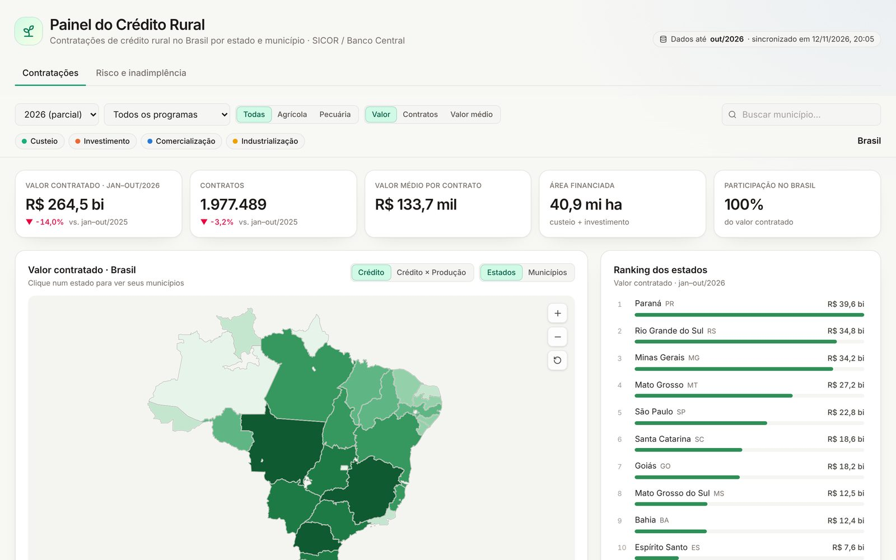
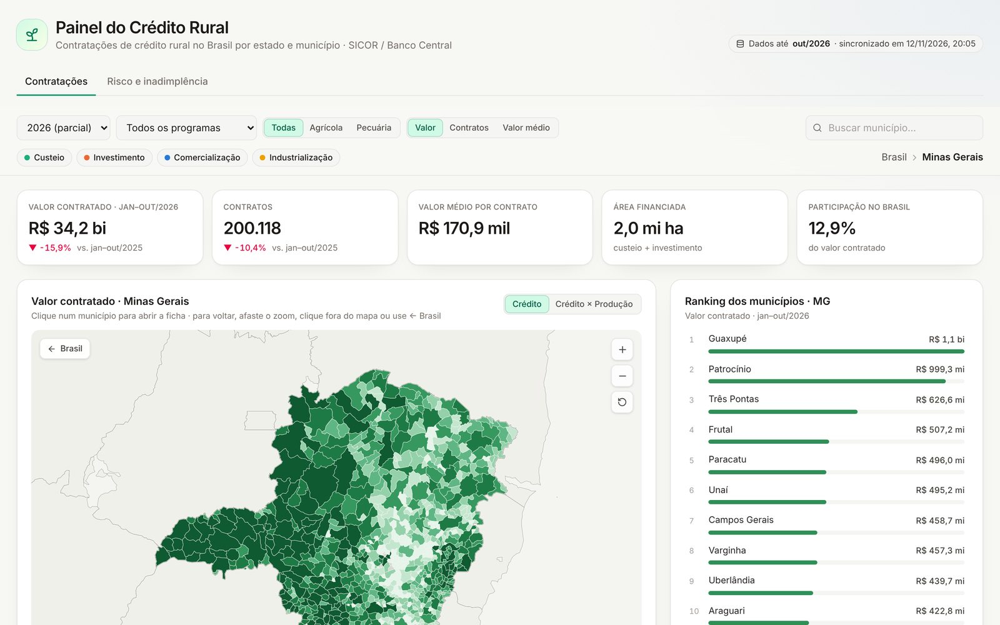
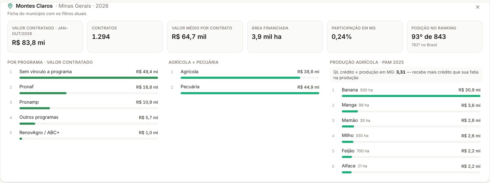
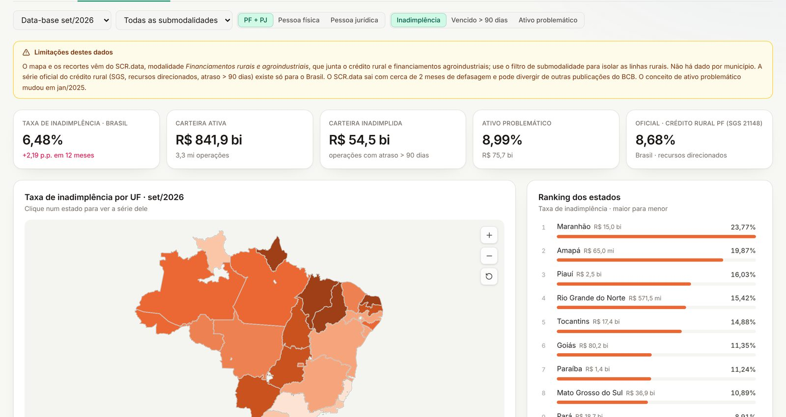
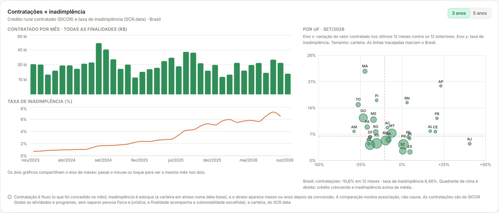
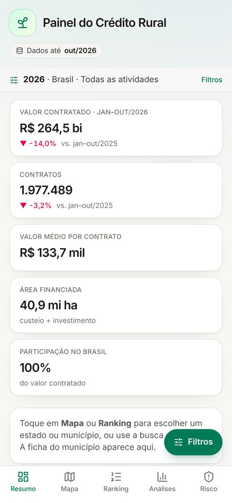
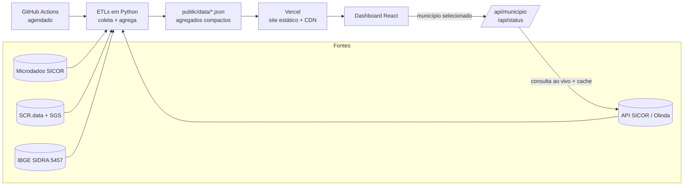

# 🌱 Painel do Crédito Rural no Brasil

[English](README.md) · **Português**

Dashboard interativo, aberto e gratuito sobre o **crédito rural no Brasil**: onde o dinheiro é contratado, para quê,
quanto da produção agrícola ele acompanha e como está a inadimplência. Os dados são oficiais do Banco Central (SICOR,
SCR.data e SGS) e do IBGE (Produção Agrícola Municipal), atualizados automaticamente.

**🔗 Acesse:** https://painel-credito-rural.vercel.app



## O que o painel mostra

### Contratações (SICOR)

- **Mapa interativo** do Brasil → estado → município, com contratações de **custeio, investimento, comercialização e
  industrialização**. Filtros por ano, atividade (agrícola/pecuária), programa (Pronaf, Pronamp, RenovAgro…) e métrica
  (valor, número de contratos ou valor médio).
- **Indicadores**: valor contratado, contratos, valor médio, área financiada e participação no Brasil. A variação é
  sempre contra o **mesmo período** do ano anterior, para não comparar ano parcial com ano fechado.
- **Ranking** de estados ou municípios, com clique para selecionar.
- **Séries** mensal e histórica (desde 2013) por finalidade.
- Quebras por **programa**, **fonte de recursos**, **sexo do beneficiário**, **produtos financiados** e **instituições
  financeiras**.
- **Ficha do município**: ao clicar num município, o painel mostra valor, contratos, área, participação no estado,
  posição no ranking estadual e nacional, programas, divisão agrícola × pecuária e as principais culturas da PAM.
- **Navegação simples no mapa**: para voltar ao Brasil, afaste o zoom, clique fora do estado ou use o botão ← Brasil.





### Crédito × produção agrícola (PAM/IBGE)

O painel cruza o crédito com a **Produção Agrícola Municipal** ([SIDRA 5457](https://sidra.ibge.gov.br/tabela/5457)),
que reúne lavouras temporárias e permanentes (inclui café, laranja, banana e cacau).

- **Mapa "Crédito × Produção"** com o quociente de localização (QL):
  QL = (crédito do município ÷ crédito da referência) ÷ (produção do município ÷ produção da referência).
  A referência é o Brasil ou, com uma UF selecionada, a própria UF.
- **Dispersão** crédito × produção por município (escala log), com a linha de QL = 1.
- **Indicadores**: R$ de crédito por R$ 100 produzidos, correlação de Spearman, % da produção em municípios sem crédito
  agrícola e número de municípios com QL ≥ 2 ou < 0,5.
- **Por cultura**: fatia no valor da produção × fatia no custeio agrícola (soja, café, milho, cana…).
- Opção **"PAM do ano seguinte"**, porque o custeio de um ano financia em boa parte a safra colhida no seguinte. Quando
  a PAM desse ano ainda não foi publicada, o painel avisa.

### Risco e inadimplência (SCR.data + SGS)

Aba própria (`?aba=risco`):

- **Mapa e ranking por UF** da taxa de inadimplência, do vencido acima de 90 dias ou do ativo problemático, com filtros
  por data-base, submodalidade (custeio, investimento, comercialização…) e pessoa física/jurídica.
- **Indicadores**: taxa, carteira ativa, carteira inadimplida, ativo problemático e a série oficial do BCB.
- **Evolução mensal** desde jun/2012, comparada às séries oficiais do crédito rural (SGS 21148 e 21136).
- **Contratações × inadimplência**: o valor contratado por mês e a taxa no mesmo eixo de tempo, e um gráfico por UF que
  cruza o crescimento das contratações em 12 meses com a inadimplência atual.
- Recortes nacionais por **porte do cliente**, **origem dos recursos** e **segmento da instituição**.





### Uso no celular

Layout próprio, com abas inferiores (Resumo, Mapa, Ranking, Análises e Risco), filtros num painel deslizante e
indicadores empilhados. Todo filtro fica na URL, então qualquer visão pode ser compartilhada
(`?ano=2026&uf=31&mun=3143302`).



## Fontes de dados

| Fonte | O que traz | Atualização no painel |
|---|---|---|
| [Microdados do SICOR](https://www.bcb.gov.br/estabilidadefinanceira/tabelas-credito-rural-proagro) (BCB) | Base principal das contratações, desde 2013 | Diária |
| [API da Matriz de Dados do Crédito Rural](https://dadosabertos.bcb.gov.br/dataset/matrizdadoscreditorural) (BCB) | Município de todas as operações e sexo do beneficiário; consulta ao vivo da ficha do município | Diária |
| [SCR.data](https://dadosabertos.bcb.gov.br/dataset/scr_data) (BCB) | Carteira e inadimplência do crédito rural por UF, desde jun/2012 | Diária |
| SGS (BCB) | Séries oficiais de inadimplência do crédito rural (21148, 21136, 21146, 21147) | Diária |
| [PAM/IBGE](https://sidra.ibge.gov.br/tabela/5457) (SIDRA 5457) | Área colhida e valor da produção por município e cultura | Semanal |
| Malhas do IBGE, via [geodata-br](https://github.com/tbrugz/geodata-br) | Contornos de estados e municípios | — |

## Metodologia e limitações

- **Valores nominais** (sem correção pela inflação), pela **data de emissão** do contrato.
- **Programas agrupados**: Pronaf (0001), Pronamp (0050), Sem vínculo (0999), RenovAgro/ABC+ (0156, 0222, 0180) e Outros.
- **Fontes agrupadas**: obrigatórios, poupança rural, LCA, livres, fundos constitucionais, BNDES/Finame e outras.
- Fonte de recursos, produtos, instituições e sexo são publicados **por UF**. Na ficha de um município, esses gráficos
  mostram o estado dele.
- **Municípios**: os microdados públicos só trazem o município das operações com recursos públicos ou Proagro (em 2023,
  78% dos contratos e 33% do valor). A API da Matriz completa os demais. O painel registra a cobertura por ano e avisa
  quando ela é parcial.
- **Crédito × produção**: só entra o crédito de atividade agrícola, porque a PAM não cobre pecuária. O QL mede
  proporção, não necessidade de crédito.
- **Inadimplência**: a modalidade do SCR.data junta crédito rural e financiamentos agroindustriais (o filtro de
  submodalidade separa as linhas); não há dado por município; o SCR.data sai com cerca de 2 meses de defasagem e pode
  divergir de outras publicações do BCB; o conceito de ativo problemático mudou em jan/2025.
- **Contratações × inadimplência**: contratação é fluxo e inadimplência é estoque, e o atraso aparece meses depois da
  concessão. A comparação mostra associação, não causa. O SICOR por UF não separa pessoa física e jurídica.
- A malha municipal simplificada não tem os municípios criados mais recentemente, e o polígono de Paraty (RJ) está
  incompleto na base de origem. Eles aparecem no ranking e na busca, mas não no mapa.
- **Conferência**: em 2023, os microdados batem com a API no custeio de MG (R$ 29.409.567.821 contra
  R$ 29.409.567.815; 120.342 contratos nos dois) e nos totais nacionais (diferença de 0,001%, por registros posteriores).

## Arquitetura



**Por que híbrido?** A API do SICOR é lenta, devolve HTTP 500 de forma intermitente e um único mês da base municipal
passa de 10 MB. Consultar tudo pelo navegador tornaria o painel inutilizável. Por isso, os ETLs rodam no GitHub
Actions, agregam os dados em JSONs compactos e fazem commit no repositório; cada commit gera um novo deploy na Vercel.
Só a ficha do município consulta o BCB ao vivo, por funções serverless com cache de CDN. O painel mostra a data da
última sincronização e avisa quando o BCB já publicou um mês que ele ainda não tem.

### ETLs e workflows

| Workflow | Script | Frequência | O que faz |
|---|---|---|---|
| `atualizar-microdados.yml` | `etl/sicor_microdados_etl.py` | Diário | Baixa os microdados mensais (`.gz`) e gera a base principal com DuckDB. Só reprocessa quando há arquivo novo. |
| `atualizar-dados.yml` | `etl/sicor_etl.py --complementar` | Diário | Completa municípios e sexo pela API. Tem disjuntor: se a API estiver fora, encerra em cerca de 1 minuto. |
| `atualizar-inadimplencia.yml` | `etl/inadimplencia_etl.py` | Diário | Baixa os arquivos anuais do SCR.data que mudaram e as séries do SGS. |
| `atualizar-pam.yml` | `etl/pam_etl.py` | Semanal | Coleta a PAM no SIDRA e reprocessa os 2 anos mais recentes (revisões do IBGE). |

Os dois workflows do SICOR compartilham um grupo de concorrência para não gravarem ao mesmo tempo.

### Arquivos gerados (`public/data`)

| Arquivo | Conteúdo |
|---|---|
| `meta.json` | anos, meses disponíveis, dicionários, origem e cobertura municipal por ano |
| `serie_anual.json` | ano × UF × atividade × programa |
| `uf_AAAA.json` | mês × UF × atividade × programa × fonte |
| `mun_AAAA.json` | município × atividade × programa (+ área) |
| `prod_AAAA.json` | UF × finalidade × produto × atividade × programa |
| `if_AAAA.json` | UF × instituição × segmento × atividade × programa |
| `gen_AAAA.json` | UF × sexo × atividade × programa |
| `municipios.json` | nomes e códigos IBGE dos municípios (busca) |
| `pam_AAAA.json`, `pam_meta.json` | produção por município e cultura; correspondência de culturas SICOR ↔ PAM |
| `inad_uf.json`, `inad_dim.json`, `inad_sgs.json`, `inad_meta.json` | inadimplência por UF, recortes nacionais, séries SGS e metadados |

Nas tabelas do SICOR, cada linha traz quantidade e valor para as 4 finalidades.

## Rodando localmente

```bash
npm install
npm run dev                 # http://localhost:5173 (sem /api: a ficha ao vivo tenta o BCB direto)
npx vercel dev              # inclui as funções /api
```

Coleta dos dados (Python 3.12):

```bash
pip install duckdb
npm run etl                                   # microdados do SICOR
npm run etl:api                               # complemento pela API
npm run etl:pam                               # PAM/IBGE
python3 etl/inadimplencia_etl.py --out public/data   # SCR.data + SGS
```

Opções úteis: `--inicio` e `--fim` (anos), `--dir-local` (usa arquivos já baixados), `--forcar` (reprocessa os
microdados), `--refresh N` e `--so-gerar` (API), `--sem-sgs` (inadimplência).

## Publicando a sua cópia

1. Faça um fork ou envie o projeto para um repositório seu.
2. Em **Settings → Actions → General → Workflow permissions**, marque **Read and write permissions** (os ETLs fazem
   commit dos dados).
3. Em **Actions**, rode manualmente cada workflow uma vez para a primeira carga. A dos microdados baixa cerca de
   1,3 GB e leva de 15 a 40 minutos.
4. Na [Vercel](https://vercel.com/new), importe o repositório. O preset **Vite** é detectado sozinho e não precisa de
   variáveis de ambiente.

## Stack

React 18 · TypeScript · Vite · Tailwind CSS 4 · MapLibre GL · Recharts · Framer Motion · Vercel Functions ·
Python · DuckDB · GitHub Actions

## Créditos e licença

- Dados: **Banco Central do Brasil** ([ODbL](https://opendatacommons.org/licenses/odbl/)) e **IBGE**
- Malha municipal: IBGE, via [tbrugz/geodata-br](https://github.com/tbrugz/geodata-br)
- Respostas de amostra da API para testes: projeto [agrobr](https://github.com/bruno-portfolio/agrobr)
- Código: [MIT](LICENSE), © Lúcio Júnio Benfica Rosa
